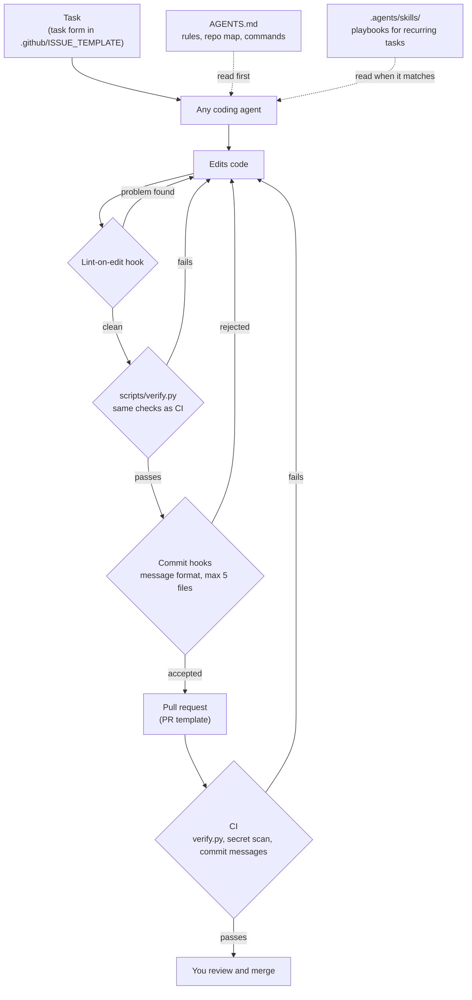
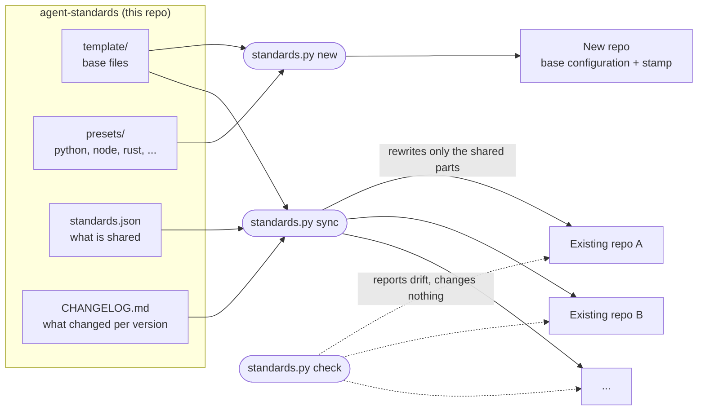

# agent-standards

A **base configuration** for software repos, so that people and coding agents (Claude Code, Codex, OpenCode,
Cursor, Copilot, Antigravity, ...) work in every repo the same way, and can prove when work is finished.
It creates new repos with that configuration in one command, and keeps existing repos up to date with it.

## Start here

| You want to... | Read |
| :--- | :--- |
| Work in a repo that already uses this (most people) | [docs/using-a-repo.md](docs/using-a-repo.md) |
| Start a new project | [docs/new-project.md](docs/new-project.md) |
| Change the rules for every repo, add a language or a coding agent | [docs/maintaining.md](docs/maintaining.md) |
| Look something up: commands, files, settings | [docs/reference.md](docs/reference.md) |
| Understand a term | [docs/glossary.md](docs/glossary.md) |

## Why this exists

Coding agents do good work when a repo tells them the rules and lets them check their own work. Without a
shared setup, every repo is different, and the agent (or a new team member) has to guess:

| Without it | With it |
| :--- | :--- |
| Each agent reads its own instruction file; the rules drift apart or are missing | One `AGENTS.md` that every agent reads |
| "Done" means "I think it works"; failures show up later in CI | One command, `verify.py`, runs exactly what CI runs: if it passes on your machine, it passes in CI |
| Lint errors pile up until someone notices | The agent is told about a lint error the moment it edits a file, and fixes it right away |
| Huge commits with vague messages, hard to review or undo | Small commits in a fixed format, each one working on its own |
| Recurring tasks are explained again every time | Skills: step-by-step playbooks any agent can follow |
| Every new project repeats the setup; fixes are copied by hand into each repo | `new` sets a project up in one command; `sync` sends a fix to every repo |

The setup does not make agents smarter. It makes their work **checkable and consistent**, which is what lets you
hand them more: you write the task, the agent does it under the repo's rules and proves it with `verify.py`, and
you review small, clear commits.

### How an agent works in a repo set up this way



Every failed check sends the work back to the agent, so most problems are fixed before a person sees them.

### How agent-standards keeps repos in line



Each repo's configuration has two layers:

- **Shared base**: the rules every repo has in common (commit rules, how `verify.py` works, the agent
  instructions that apply everywhere). Changed only here, and sent to every repo with `sync`.
- **The repo's own configuration**: its checks, commit scopes, repo map, CI install steps and skills. The repo
  changes these freely; `sync` never touches them.

The full list is in [docs/reference.md](docs/reference.md#what-is-shared-and-what-each-repo-owns).

## Where to clone it

Clone this repo **next to** the repos it manages, in the folder that holds your projects, not inside one of them:

```
~/projects/
├── agent-standards/      ← this repo
├── my-api/               ← managed: has an .agent-standards file
├── my-web/               ← managed
├── clients/
│   └── my-sdk/           ← managed (one level deeper is searched too)
└── some-other-repo/      ← ignored: no .agent-standards file
```

```bash
cd ~/projects
git clone git@github.com:luisenriquecgongora/agent-standards.git
# or: git clone https://github.com/luisenriquecgongora/agent-standards.git
```

`check` and `sync` find managed repos by looking for an `.agent-standards` file in the folder above this one and
one level below it (`"discover"` in `standards.json`). Cloned somewhere else? Everything still works: name the
repos instead, e.g. `python standards.py check ~/code/my-api ~/work/my-web`.

## Quick start

Needs Python 3.10+, git and bash (Git Bash on Windows). Full steps in [docs/new-project.md](docs/new-project.md).

```bash
cd ~/projects/agent-standards
python standards.py new ../my-app --name my-app --stack python,node --scopes api,web
cd ../my-app
git init -b main && git add -A && git commit -m "chore: start from agent standards"
bash scripts/setup-hooks.sh
python scripts/verify.py
```

See what that creates in [`examples/my-app/`](examples/my-app/), the exact output of the `new` command above,
kept current by a test. (Its `.github/` files are inactive there: GitHub only runs workflows at a repo's root.)

Keep repos up to date:

```bash
python standards.py check     # which repos differ from the template (changes nothing)
python standards.py sync      # update their shared parts; review with git diff, then commit in each repo
```
