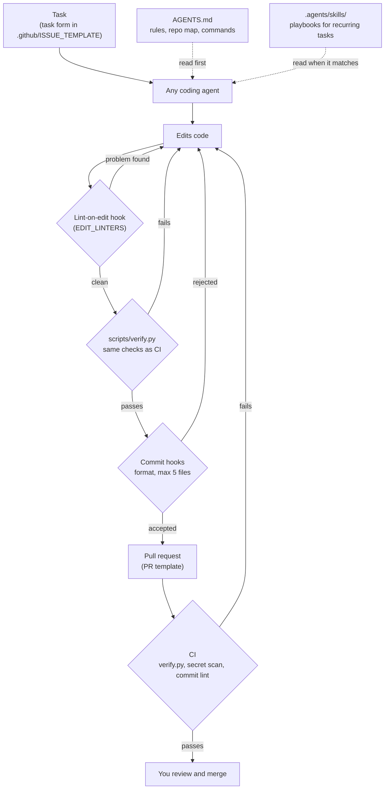
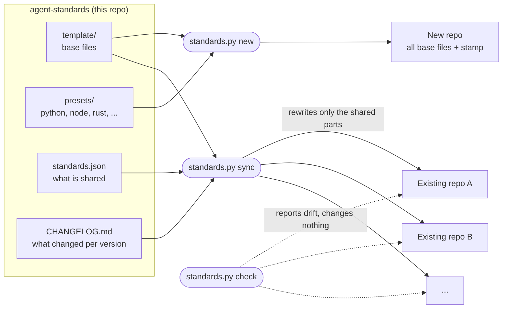

# agent-standards

One shared engineering setup for any number of repos, any language and any coding agent:

- `scripts/verify.py` is the definition of done: CI and local runs execute the same checks.
- `AGENTS.md` holds the instructions every coding agent reads (Claude Code via `CLAUDE.md`, Codex,
  OpenCode, Cursor, Copilot, Antigravity, ...). Skills live once in `.agents/skills/` and are linked
  for tools that only read their own folder.
- Commit-message and commit-size hooks, lint-on-edit feedback for agents, CI, Dependabot, PR and task templates.

## Why this exists

Coding agents (Claude Code, Codex, OpenCode, Antigravity, ...) do good work when a repo tells them the rules
and lets them prove the work is finished. Without a shared setup, every repo is different, and the agent guesses:

| Without it | With it |
| :--- | :--- |
| Each agent reads its own instruction file; the rules drift apart or are missing | One `AGENTS.md` that every agent reads |
| "Done" means "I think it works"; failures show up later in CI | `verify.py` runs exactly what CI runs, so "passes here" means "passes in CI" |
| Lint errors pile up until someone notices | The agent is told about a lint error the moment it edits the file, and fixes it in the same turn |
| Huge commits with vague messages, hard to review or undo | Small commits in a fixed format, each one passing on its own |
| Recurring tasks are re-explained every time | Skills: step-by-step playbooks any agent can follow |
| Every new project repeats the setup; fixes are copied by hand into each repo | `new` sets a project up in one command; `sync` sends a fix to every repo |

The setup does not make agents smarter. It makes their work **checkable and consistent**, which is what lets you
hand them more: you write the task, the agent does it under the repo's rules and proves it with `verify.py`,
and you review small, clear commits.

### How an agent works in a repo set up this way



### How agent-standards keeps repos in line



## Where to clone it

Clone this repo **next to** the repos it manages, in the folder that holds your projects, not inside one of them:

```
~/projects/
├── agent-standards/      ← this repo
├── my-api/               ← managed: has an .agent-standards file
├── my-web/               ← managed
├── clients/
│   └── my-sdk/           ← managed (one level deeper is searched too)
└── some-other-repo/      ← ignored: no .agent-standards file
```

```bash
cd ~/projects
git clone git@github.com:luisenriquecgongora/agent-standards.git
python agent-standards/standards.py check
```

`check` and `sync` without arguments look for repos with an `.agent-standards` file in the folder above this one
(`"discover": {"root": "..", "max_depth": 2}` in `standards.json`; `..` is relative to this repo). Paths in the
commands below, like `../my-app`, are examples relative to this repo.

Cloned somewhere else? Everything still works; name the repos instead of relying on discovery:

```bash
python standards.py check ~/code/my-api ~/work/my-web
```

## Start a new repo

```bash
python standards.py stacks                                    # python, node, rust, ...
python standards.py new ../my-app --name my-app --stack python,node --scopes api,web
cd ../my-app
git init && git add -A && git commit -m "chore: start from agent standards"
bash scripts/setup-hooks.sh        # after the first commit: the hook caps commits at 5 files
```

The `new` command above creates the layout below. Browse the full result in
[`examples/my-app/`](examples/my-app/): it is exactly what that command generates (a test keeps it current).
Its `.github/` files are inactive there, because GitHub only runs workflows at a repo's root.

```
my-app/
├── .agents/
│   └── skills/
│       └── review-change/
│           └── SKILL.md          ← review checklist; add the repo's own skills next to it
├── .claude/
│   ├── hooks/
│   │   └── lint_edited.py        ← lints each file an agent edits (EDIT_LINTERS in verify.py)  [synced]
│   ├── skills/
│   │   └── review-change -> ../../.agents/skills/review-change   ← symlink, for Claude Code
│   └── settings.json             ← agent permissions and the lint hook
├── .github/
│   ├── ISSUE_TEMPLATE/
│   │   └── task_spec.yml         ← task form an agent or a person can pick up
│   ├── workflows/
│   │   ├── ci.yml                ← runs verify.py, plus Python and Node setup steps from the stacks
│   │   └── lint-commits.yml      ← checks commit messages on pull requests  [synced]
│   ├── dependabot.yml            ← pip, npm and GitHub Actions updates
│   └── PULL_REQUEST_TEMPLATE.md
├── scripts/
│   ├── setup-hooks.sh            ← installs the commit-msg and pre-commit hooks  [synced]
│   └── verify.py                 ← definition of done: ruff, pytest and tsc for these stacks  [synced, except its config block]
├── .agent-standards              ← {"version": "1.1.0", "stacks": ["python", "node"]}
├── .commitlintrc.json            [synced]
├── .gitignore                    ← .env plus .venv/, __pycache__/, node_modules/, dist/, ...
├── AGENTS.md                     ← instructions for every coding agent; scopes `api`, `web`  [sections 1, 2, 4, 10 synced]
└── CLAUDE.md                     ← "@AGENTS.md", so Claude Code reads the same instructions  [synced]
```

`[synced]` parts are kept identical across repos by `sync`; everything else belongs to the new repo.
Each stack adds its checks to `verify.py`, its lint-on-edit rule, its CI setup steps, its Dependabot
entry and its `.gitignore` lines. Then fill in the `TODO`s in `AGENTS.md` and
`.agents/skills/review-change/SKILL.md`, and adjust `CHECKS` and the CI install steps to the real layout.

## Keep repos in line

Every managed repo has an `.agent-standards` stamp with the template version and its stacks.

```bash
python standards.py check            # every stamped repo under the discover root (standards.json)
python standards.py check ../moza --diff
python standards.py sync             # rewrite the shared parts, print the changelog since each repo's version
```

`sync` never commits: review with `git diff` and commit in each repo as usual. A repo without a stamp gets one
on its first `sync`; list its stacks in it.

## Change the standards

1. Edit the shared file under `template/` (see the table below for what is shared).
2. Bump `version` in `standards.json` and add a `CHANGELOG.md` entry.
3. `pytest -q tests`, then `python standards.py sync` and commit in each repo.

Editing a shared file in a single repo makes `check` report it until the template or the repo is brought back in line.

## What is shared and what each repo owns

Configured in `standards.json`; nothing about which files are shared is hard-coded.

| Synced (identical in every repo) | Starting point only (the repo owns it after `new`) |
| :--- | :--- |
| `synced_files`: `CLAUDE.md`, `scripts/setup-hooks.sh`, `.claude/hooks/lint_edited.py`, `.commitlintrc.json`, `.github/workflows/lint-commits.yml` | `AGENTS.md` sections not in `shared_sections` (scopes, map, commands, gotchas, never) |
| `scripts/verify.py` outside its configuration block | `CHECKS`, `EDIT_LINTERS`, `VENV`, `SKILL_MIRRORS` in that block |
| `AGENTS.md` `shared_sections` (1, 2, 4, 10) | `.agents/skills/`, `.claude/settings.json`, CI, Dependabot, PR and task templates |

## Add a stack

Create `presets/<stack>/` with:

| File | Contents |
| :--- | :--- |
| `preset.json` | `description`; `checks` (verify.py `CHECKS` entries); `edit_linters` (extension -> lint command, `{file}` is the edited file); `gitignore` lines |
| `ci-steps.yml` | GitHub Actions steps, indented for `jobs.verify.steps`, run before Verify |
| `dependabot.yml` | One `updates:` entry, indented two spaces |

Commands may use `{py}`, `{ruff}`, `{yarn}` or any `{tool}` on PATH (`{cargo}`, `{go}`); a missing tool skips
the check instead of failing it. The tests render every preset, so `pytest -q tests` checks a new one.

## Add a coding agent

Tools that read `AGENTS.md` and `.agents/skills/` need nothing. For a tool that only reads its own skills
folder, add that folder to `SKILL_MIRRORS` in each repo's `verify.py` (and in `template/scripts/verify.py`) and
run `python scripts/verify.py --only skills --fix`. See section 10 of `template/AGENTS.md`.
