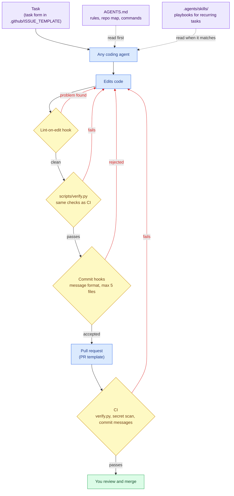
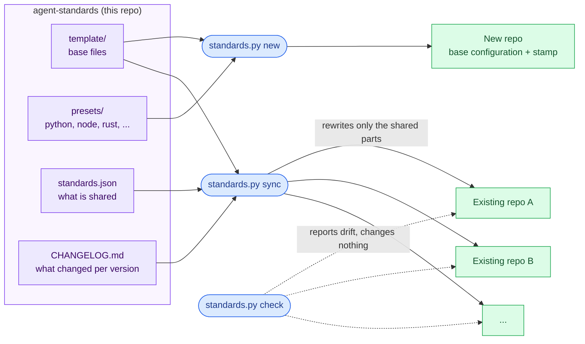
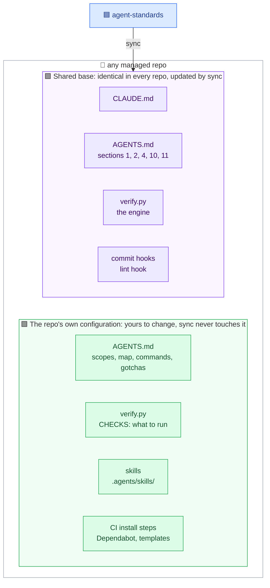
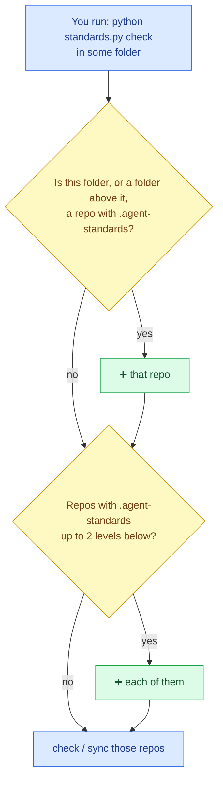
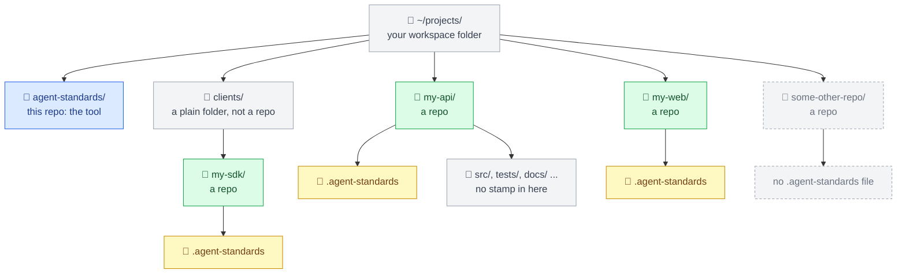
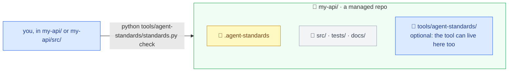
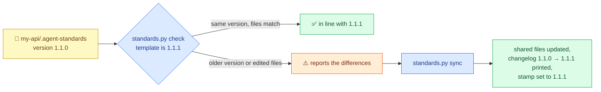

# agent-standards

A **base configuration** for software repos, so that people and coding agents (Claude Code, Codex, OpenCode,
Cursor, Copilot, Antigravity, ...) work in every repo the same way, and can prove when work is finished.
It creates new repos with that configuration in one command, and keeps existing repos up to date with it.

## Start here

| You want to... | Read |
| :--- | :--- |
| Work in a repo that already uses this (most people) | [docs/using-a-repo.md](docs/using-a-repo.md) |
| Start a new project | [docs/new-project.md](docs/new-project.md) |
| Change the rules for every repo, add a language or a coding agent | [docs/maintaining.md](docs/maintaining.md) |
| Look something up: commands, files, settings | [docs/reference.md](docs/reference.md) |
| Understand a term | [docs/glossary.md](docs/glossary.md) |

## Why this exists

Coding agents do good work when a repo tells them the rules and lets them check their own work. Without a
shared setup, every repo is different, and the agent (or a new team member) has to guess:

| Without it | With it |
| :--- | :--- |
| Each agent reads its own instruction file; the rules drift apart or are missing | One `AGENTS.md` that every agent reads |
| "Done" means "I think it works"; failures show up later in CI | One command, `verify.py`, runs exactly what CI runs: if it passes on your machine, it passes in CI |
| Lint errors pile up until someone notices | The agent is told about a lint error the moment it edits a file, and fixes it right away |
| Huge commits with vague messages, hard to review or undo | Small commits in a fixed format, each one working on its own |
| Recurring tasks are explained again every time | Skills: step-by-step playbooks any agent can follow |
| Agents change code faster than people can read it; nobody can say what changed or why | Every repo keeps `docs/ARCHITECTURE.md`, a colored map of its parts, current, and every pull request explains what, why and how it was verified, with a diagram when a flow changed |
| Every new project repeats the setup; fixes are copied by hand into each repo | `new` sets a project up in one command; `sync` sends a fix to every repo |

The setup does not make agents smarter. It makes their work **checkable and consistent**, which is what lets you
hand them more: you write the task, the agent does it under the repo's rules and proves it with `verify.py`, and
you review small, clear commits.

### How an agent works in a repo set up this way



🟪 what the agent reads · 🟦 the work · 🟨 automatic checks · 🟩 finished · red arrows: a check failed, back to work

Every failed check sends the work back to the agent, so most problems are fixed before a person sees them.

### How agent-standards keeps repos in line



🟪 the source of the standards · 🟦 the commands · 🟩 your repos

Each repo's configuration has two layers:

- **Shared base**: the rules every repo has in common (commit rules, how `verify.py` works, the agent
  instructions that apply everywhere). Changed only here, and sent to every repo with `sync`.
- **The repo's own configuration**: its checks, commit scopes, repo map, CI install steps and skills. The repo
  changes these freely; `sync` never touches them.



Some files have a part in each layer: in `AGENTS.md` four sections are shared and the rest are the repo's; in
`verify.py` the program is shared and its configuration block (`CHECKS`, ...) is the repo's.
The full list is in [docs/reference.md](docs/reference.md#what-is-shared-and-what-each-repo-owns).

## Where to put it, and where to run it

`agent-standards` can live anywhere, and works on **one repo or a whole folder of repos**. Like git, it looks at
**the folder you run it in**:

| You run `check` or `sync` in... | It manages |
| :--- | :--- |
| A folder of repos (`~/projects/`) | Every managed repo in it, up to two folder levels down |
| A managed repo, or any folder inside it (`my-api/src/`) | That repo |
| A repo that is also a workspace (it has its own stamp and managed repos inside it) | That repo and the managed repos inside it |
| The `agent-standards` folder itself | The repos in the folder that holds it |

A repo is **managed** when it has an `.agent-standards` file at its root (see the next section). Folders without
one are ignored. To start from another folder, add `--root <folder>`; to pick repos yourself, name them:
`python standards.py check ~/code/my-api ~/work/my-web`.



### Layout 1: a folder of repos

The usual setup: clone `agent-standards` next to your repos and run it there.



| Color | Meaning |
| :--- | :--- |
| 🟦 Blue | `agent-standards`, the tool |
| 🟩 Green | A **managed** repo: it has a stamp file at its root |
| 🟨 Yellow | The stamp file, `.agent-standards`: **one per repo, at the repo's root** |
| ⬜ Grey | Plain folders, and folders inside a repo: never have a stamp |
| ⬜ Grey, dashed | A repo without a stamp: `check` and `sync` ignore it |

```bash
cd ~/projects
git clone git@github.com:luisenriquecgongora/agent-standards.git
# or: git clone https://github.com/luisenriquecgongora/agent-standards.git
python agent-standards/standards.py check            # all managed repos in ~/projects
```

### Layout 2: one repo

Keep `agent-standards` anywhere (your home folder, a tools folder, or even inside the repo, e.g.
`my-api/tools/agent-standards/`) and run it from inside the repo:



```bash
cd ~/code/my-api
python ~/tools/agent-standards/standards.py check    # just my-api
```

The tool never treats itself or its `examples/` as a repo to manage, wherever it lives.

## The `.agent-standards` file

Every managed repo has **exactly one** `.agent-standards` file, at its root, next to `AGENTS.md`. Folders
inside the repo (`src/`, `packages/api/`, ...) never have one, even in a monorepo with many packages. It looks
like this:

```json
{
  "version": "1.1.1",
  "stacks": ["node", "python"]
}
```

| Field | Means | Written by |
| :--- | :--- | :--- |
| `version` | Which release of the standards this repo has | `new`, then `sync` every time it updates the repo |
| `stacks` | Which languages the repo uses | `new` (from `--stack`); you, for a repo brought in later |

It has two jobs: it **marks** the repo as managed, so `check` and `sync` find it, and it **records the version**,
so they know what the repo is missing:



Do not edit `version` by hand: `sync` sets it after updating the files, so it always matches what the repo
really has.

## Quick start

Needs Python 3.10+, git and bash (Git Bash on Windows). Full steps in [docs/new-project.md](docs/new-project.md).

```bash
cd ~/projects/agent-standards
python standards.py new ../my-app --name my-app --stack python,node --scopes api,web
cd ../my-app
git init -b main && git add -A && git commit -m "chore: start from agent standards"
bash scripts/setup-hooks.sh
python scripts/verify.py
```

See what that creates in [`examples/my-app/`](examples/my-app/), the exact output of the `new` command above,
kept current by a test. (Its `.github/` files are inactive there: GitHub only runs workflows at a repo's root.)

Keep repos up to date:

```bash
python standards.py check     # which repos differ from the template (changes nothing)
python standards.py sync      # update their shared parts; review with git diff, then commit in each repo
```
