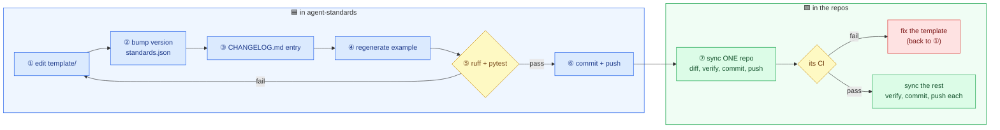

# Maintaining the standards

For whoever changes the rules that every repo shares, or adds a stack or a coding agent. Unfamiliar words
are in the [glossary](glossary.md); what is shared is listed in [reference.md](reference.md).

## The one rule

**Change shared files here, never in a single repo.** A shared file edited in one repo is overwritten by the
next `sync`, and `check` reports it as drift until then.

## See where every repo stands

```bash
cd ~/projects/agent-standards
python standards.py check
```

```
== my-api: in line with 1.1.0
== my-web: 2 difference(s)
   .agent-standards: on 1.0.0, template is 1.1.0
   scripts/verify.py: differs from the template (18 lines)
```

`check` changes nothing. Add `--diff` to see each difference, or name repos to check only those:
`python standards.py check ../my-web --diff`.

## Change a shared rule



1. **Edit the file under `template/`.** For example `template/scripts/setup-hooks.sh`, or a shared section
   (1, 2, 4, 10 or 11) of `template/AGENTS.md`.
2. **Bump the version** in `standards.json`, using [semantic versioning](https://semver.org):

   | Bump | When | Example |
   | :--- | :--- | :--- |
   | patch `1.1.0 → 1.1.1` | Wording or a bug fix; nothing changes for repos | A typo in a hook message |
   | minor `1.1.0 → 1.2.0` | Something new that repos may use; old repos keep working | A new optional `verify.py` setting |
   | major `1.1.0 → 2.0.0` | Repos must change something by hand after `sync` | A configuration setting is renamed |

3. **Describe it in `CHANGELOG.md`** under a new `## <version>` heading, as a list of what changed and what a
   repo needs to do, if anything. `sync` prints this to everyone who updates.
4. **Regenerate the example** if the change affects new repos (it usually does):

   ```bash
   rm -rf examples/my-app
   python standards.py new examples/my-app --name my-app --stack python,node --scopes api,web
   ```

5. **Run the tests**: `pip install pytest pyyaml ruff`, then `ruff check .` and `pytest -q tests`. They build a
   repo from every stack, check that sync repairs only shared parts, and fail if the example is stale.
6. **Commit and push** this repo.
7. **Roll out** (next section).

## Roll a change out to the repos

Try it on one repo first, then the rest:

```bash
python standards.py sync ../my-api
```

```
== my-api
   1.1.0 -> 1.2.0; changes:
     ## 1.2.0
     - ...
   updated scripts/verify.py
```

Then, in that repo:

1. `git diff`: only the shared parts should have changed. `sync` never touches the repo's own settings.
2. `python scripts/verify.py`: must pass.
3. `bash scripts/setup-hooks.sh` if the hook script changed: installed hooks are copies and need refreshing.
4. Commit only the synced files, e.g. `build(hooks): sync agent standards 1.2.0`, and push. Wait for CI.

When that repo's CI passes, run `python standards.py sync` without arguments to update every repo, and repeat
the steps in each. `sync` never commits, so nothing is published until you commit and push in each repo.

**Careful with repos where someone is working.** Commit only the synced files (`git commit -- <files>`), and
check `git status` first so you do not commit someone else's changes. If the branch has commits that are not
pushed yet, pushing publishes them too: ask first.

## Bring an existing repo under the standards

For a repo that was not created with `new`:

1. Copy what it lacks from `template/` (at least `scripts/verify.py`, `AGENTS.md`, `CLAUDE.md`,
   `scripts/setup-hooks.sh`), and fill in the repo-specific parts.
2. Run `python standards.py sync ../that-repo`. It creates the `.agent-standards` stamp; put the repo's stacks
   in it.
3. `python standards.py check ../that-repo` should report no differences.

## Add a stack

Create `presets/<stack>/` (for example `presets/go/`) with three files:

**`preset.json`**

```json
{
  "description": "Go: go vet, go test, gomod updates",
  "checks": [
    ["go", "vet", ".", ["{go}", "vet", "./..."]],
    ["go", "tests", ".", ["{go}", "test", "./..."]]
  ],
  "edit_linters": {},
  "gitignore": ["bin/"]
}
```

- `checks` become entries of `CHECKS` in the new repo's `verify.py`: `[group, name, folder, command]`.
- `edit_linters` maps a file extension to the lint command run when an agent edits such a file; `{file}` is
  the edited file. Only use fast, single-file linters.
- Commands may use `{py}`, `{ruff}`, `{yarn}` or any `{tool}` on PATH such as `{go}` or `{cargo}`. If the tool is
  missing, that check is skipped and reported, not failed.

**`ci-steps.yml`**: the GitHub Actions steps that install the tools, indented six spaces (they are inserted
into `jobs.verify.steps`, before the Verify step):

```yaml
      - uses: actions/setup-go@v5
        with:
          go-version: stable
```

**`dependabot.yml`**: one entry for `updates:`, indented two spaces:

```yaml
  - package-ecosystem: gomod
    directory: /
    schedule: { interval: weekly, day: monday }
    commit-message: { prefix: build, include: scope }
```

Then `pytest -q tests`: the tests build a repo with every preset and check that the YAML is valid. A new
stack only affects new repos; existing repos add its checks by hand to their own `verify.py`.

## Add a coding agent

Most agents read `AGENTS.md` and `.agents/skills/` already, and need nothing.

For an agent that only reads its own folder:

1. If it needs its own instruction file (like Claude Code's `CLAUDE.md`), add a one-line pointer file to
   `template/` that tells it to read `AGENTS.md`, and add it to `synced_files` in `standards.json`.
2. If it reads skills only from its own folder, add that folder to `SKILL_MIRRORS` in
   `template/scripts/verify.py`, and in each repo's `verify.py` (it is part of the repo's configuration block,
   which `sync` does not touch). Then run `python scripts/verify.py --only skills --fix` in each repo to create
   the links.
3. Check that the agent lists the skills, then follow "Change a shared rule" above to release it.

## Make something shared, or stop sharing it

Edit `standards.json`:

- `synced_files`: files that must be identical in every repo.
- `agents.shared_sections`: the `AGENTS.md` section numbers that must be identical.
- `verify`: where the repo-specific configuration block of `verify.py` starts and ends.
- `discover`: `max_depth` is how many folder levels below the current folder `check` and `sync` search for
  managed repos (default 2).

Adding a file to `synced_files` is a minor version; `check` then reports every repo where that file differs,
and `sync` makes them identical.
