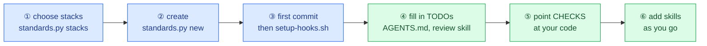

# Starting a new project

Create a repo that has the standards from its first commit. Takes about 10 minutes, most of it filling in
`AGENTS.md`. Unfamiliar words are in the [glossary](glossary.md).

## Before you start

| You need | Check with | Notes |
| :--- | :--- | :--- |
| Python 3.10 or newer | `python --version` | Runs `standards.py` and, later, the new repo's `verify.py` |
| Git | `git --version` | |
| Bash | `bash --version` | On Windows: **Git Bash**, installed with Git for Windows |
| **Windows only:** symlinks enabled | `git config --get core.symlinks` prints `true` | Turn on Developer Mode (Settings → System → For developers), then `git config --global core.symlinks true` |

And a clone of this repo (see [Where to put it](../README.md#where-to-put-it-and-where-to-run-it)).

The whole process at a glance:



🟦 commands you run (a few minutes) · 🟩 what only you can write (most of the time)

## 1. Choose your stacks

```bash
cd ~/projects/agent-standards
python standards.py stacks
```

```
node       Node / TypeScript: tsc typecheck, npm updates (add eslint to EDIT_LINTERS once the repo has it)
python     Python: ruff lint, pytest, pip updates
rust       Rust: clippy with warnings as errors, cargo test, cargo updates
```

Pick every language the project will use. You can also pick none and add checks by hand later.

## 2. Create the repo

```bash
python standards.py new ../my-app --name my-app --stack python,node --scopes api,web
```

| Option | Meaning |
| :--- | :--- |
| `../my-app` | Where to create it. Must not exist yet, or be empty (`new` never overwrites a project) |
| `--name` | The project name, used in the title of `AGENTS.md` |
| `--stack` | Comma-separated stacks from step 1 |
| `--scopes` | The parts of the project, used in commit messages (`fix(api): ...`). `config`, `deps`, `hooks`, `ci` and `docs` are always added |

**What happens:** it copies `template/`, adds each stack's checks, lint rule, CI steps, Dependabot entry and
`.gitignore` lines, writes the `.agent-standards` stamp, and links the skills for Claude Code. It ends by
running the new repo's skill check, which should print `verify: all checks passed`.

You get the layout shown in [`examples/my-app/`](../examples/my-app/), which is exactly what this command
generates.

This is a **base configuration**: it works as it is, and you build on it. Two layers:

- **Shared base** (marked `[synced]` in [reference.md](reference.md#every-file-in-a-new-repo)): the rules every repo has in common. Do not
  edit them in your repo; change them in `agent-standards` so every repo gets the change
  ([maintaining.md](maintaining.md)).
- **Your configuration** (everything else): checks, scopes, repo map, CI install steps, skills. These are
  yours to change; `sync` never touches them. Steps 4 to 6 below are where you customize them.

## 3. Make the first commit, then install the hooks

```bash
cd ../my-app
git init -b main
git add -A
git commit -m "chore: start from agent standards"
bash scripts/setup-hooks.sh
```

The order matters: the commit hook allows at most 5 files per commit, and the template has more, so the
first commit happens before the hooks are installed. From now on, every commit goes through them.

To publish it, create an **empty** repository on GitHub (no README, no .gitignore, no license), then:

```bash
git remote add origin git@github.com:<you>/my-app.git
git push -u origin main
```

## 4. Fill in what only you know

Search for `TODO`:

| File | What to write |
| :--- | :--- |
| `AGENTS.md` section 6, *Repository Map* | One row per folder that matters: what it contains |
| `AGENTS.md` section 7, *Commands* | How to install, run and test the project |
| `AGENTS.md` section 8, *Gotchas* | What a newcomer would get wrong: hard-coded ports, generated files, build order |
| `.agents/skills/review-change/SKILL.md` | The checks a reviewer must not forget in this repo |
| `docs/ARCHITECTURE.md` | A colored diagram of the repo's parts and how data flows between them, using the palette at its top. People use it to follow changes made faster than they can read code |

Write these for a new team member. An agent reads them before every task, so precise beats long.

## 5. Point the checks at your real code

The stack checks assume a standard layout (code at the root). Open `scripts/verify.py`; near the top is
the configuration block:

```python
CHECKS: list[tuple[str, str, str, list[str]]] = [
    ("python", "ruff", ".", ["{ruff}", "check", "."]),
    ("python", "tests", ".", ["{py}", "-m", "pytest", "-q"]),
    ("node", "typecheck", ".", ["{yarn}", "tsc", "--noEmit"]),
]
```

Each entry is `(group, name, folder to run in, command)`. Change the folder or command to match your
project, for example `("python", "tests", "services/api", ["{py}", "-m", "pytest", "-q"])`. Also check
the install steps in `.github/workflows/ci.yml`. Then run `python scripts/verify.py`: the same checks will
run in CI.

`pytest` fails when there are no tests yet, so add a first test, or comment that check out until there is one.

## 6. Add skills as the project grows

When you notice you explain the same task to an agent twice, write it down as a skill:

```
.agents/skills/add-endpoint/SKILL.md
```

```markdown
---
name: add-endpoint
description: Add an HTTP endpoint to the API. Use when asked to add or change a route.
---

# Add an endpoint
1. ...
```

`name` must match the folder name, and `description` says when to use it. Then run
`python scripts/verify.py --only skills --fix`, which links it for Claude Code and checks the frontmatter.
List the new skill in `AGENTS.md` section 6.

## Next

Day-to-day work in the repo: [using-a-repo.md](using-a-repo.md).
