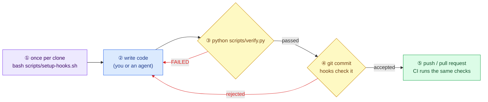
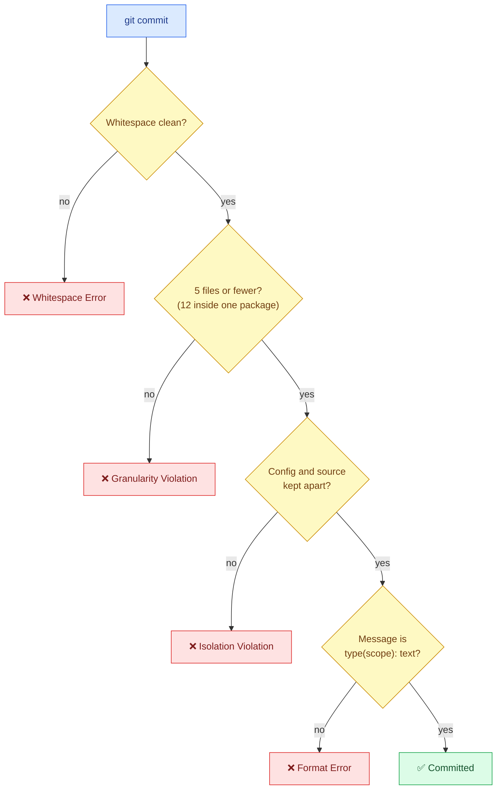

# Working in a repo that uses these standards

For everyone who writes code in one of our repos, by hand or with a coding agent. You do not need the
`agent-standards` repo for any of this: everything below is already inside the repo you work in.

Words you may not know are explained in the [glossary](glossary.md).

## In short

1. Once per clone: `bash scripts/setup-hooks.sh`.
2. Before you say a task is done: `python scripts/verify.py` passes.
3. Commit small, with messages like `fix(api): handle empty request`.



🟪 once · 🟦 your work · 🟨 automatic checks · 🟩 shared with the team · red arrows: fix and try again

## 1. Set up once per clone

After cloning the repo, from its root folder:

```bash
bash scripts/setup-hooks.sh
```

**What happens:** it installs two git hooks on your machine (`commit-msg` and `pre-commit`) and sets a few
local git options (line endings, whitespace, rename detection). Hooks are not copied by `git clone`, so every
clone needs this once. It is safe to run again. If you already had hooks, they are kept and still run
(renamed to `commit-msg.local` / `pre-commit.local`).

On Windows, run it in **Git Bash** (installed with Git for Windows).

## 2. Check your work with verify.py

```bash
python scripts/verify.py                 # everything
python scripts/verify.py --only python   # one group, faster while you iterate
```

**What happens:** it runs every check that CI runs (linters, tests, type checks, a secret scan), in order, and
stops at the first failure. The groups and commands are listed in the `CHECKS` setting near the top of
`scripts/verify.py`, and `AGENTS.md` section 5 describes them for this repo.

How to read the result:

| Last line | Meaning | What to do |
| :--- | :--- | :--- |
| `verify: all checks passed` | Done | Commit |
| `verify: passed, but NOT COMPLETE. Skipped: ...` | Some checks could not run because a tool is not installed (often `gitleaks` or `ruff`) | Install the listed tool, or say clearly which checks were skipped. CI still runs them |
| `FAILED: <check>` | That check found a problem | Read the output above it, fix, run again |

It uses the repo's virtual environment (`.venv`) when there is one, so you do not need to activate it. To use
another Python (for example in a git worktree), set `VERIFY_PYTHON=/path/to/python`.

## 3. Commit the way the hooks expect

### Message format

```
<type>(<scope>): <short description of the change, imperative, 72 characters at most>
```

- **type**: `feat` (new feature), `fix` (bug fix), `refactor` (restructure without changing behavior),
  `perf`, `test`, `docs`, `build`, `ci`, `chore`; for machine-learning work also `model`, `data`, `eval`, `exp`.
- **scope** (optional, recommended): which part of the repo changed. The allowed scopes are in the repo's
  `AGENTS.md`, section 3.
- **Breaking change**: add `!` before the colon: `feat(api)!: remove v1 endpoints`.

| Good | Rejected, and why |
| :--- | :--- |
| `fix(api): handle empty request body` | `fixed stuff` (no type) |
| `feat(web): add dark mode toggle` | `Feat(web): add toggle` (types are lowercase) |
| `docs: explain local setup` | `fix(api) handle empty body` (missing colon) |
| `refactor(core): rename Parser to Lexer` | `fix(api):` (no description) |

Messages git writes itself (`Merge ...`, `Revert "..."`, `fixup! ...`) are always accepted.

### Size and content of a commit

What happens when you run `git commit`:



The first three checks are the `pre-commit` hook; the message check is the `commit-msg` hook. A rejected
commit is not made: fix the problem and run `git commit` again. In detail, the `pre-commit` hook rejects a
commit that:

| Rule | Why | Fix |
| :--- | :--- | :--- |
| Has trailing whitespace or broken line endings | Noise in the diff | Remove it; most editors can trim on save |
| Touches more than **5 files** (12 if every file is inside one `packages/<name>/` or `apps/<name>/` folder) | Small commits are easy to review and safe to undo | Split the work into several commits |
| Mixes build configuration (`tsconfig`, `vite.config`, `Dockerfile`, `.env`, ...) with source code (`src/`, `lib/`, `packages/`, `apps/`) | Config changes are reviewed separately | Commit the config on its own, e.g. `chore(config): ...` |

Not counted toward the 5 files: lockfiles (`yarn.lock`, `uv.lock`, `Cargo.lock`, ...), Markdown files,
`.test.` / `.spec.` files, migrations, `.sql` files and translation files.

A good order for one task: first `refactor` commits (structure only), then `feat` / `fix` (the behavior
change), then `test`. Every commit should pass `verify.py` on its own.

## 4. Working with a coding agent

Nothing to configure. The agent reads `AGENTS.md` (Claude Code through `CLAUDE.md`) and follows the same rules
you do. What it adds:

- **Skills**: before a recurring task (for example reviewing a change), the agent reads the matching playbook
  in `.agents/skills/`. Ask it to "review this change" and it follows `review-change`.
- **Lint-on-edit**: in Claude Code, every file the agent edits is linted at once, and problems go straight
  back to the agent. You see fewer lint failures later.
- **Guard rails** (`.claude/settings.json`): Claude Code may not read `.env` files or `credentials/`, and may
  not force-push or `rm -rf`.

A good way to hand over a task: open an issue with the **Task spec** form (Goal, Acceptance criteria, Where
to look, Out of scope, How to verify) and give the agent that issue. It has everything it needs without asking.

## Troubleshooting

**`❌ [Format Error] Invalid commit message`**
The message does not match `<type>(<scope>): <description>`. See the table above. The commit was not
made, so just run `git commit` again with a fixed message; your staged changes are still staged.

**`❌ [Granularity Violation] Commit touches N files (Limit: 5)`**
Unstage some files (`git restore --staged <file>`) and commit them in a separate commit.

**`❌ [Isolation Violation] Staged changes mix build configuration and application source`**
Commit the configuration files first on their own, then the source.

**`... must be a symlink to .agents/skills/...`** (from `verify.py`)
Skill links are missing, which happens on Windows when git cannot create symlinks. Turn on **Developer
Mode** (Windows Settings → System → For developers), run `git config core.symlinks true`, then
`python scripts/verify.py --only skills --fix`.

**`verify.py` cannot find a tool**
It skips that check and lists it under "NOT COMPLETE". Install the tool (see the repo's `AGENTS.md`, section
7, for the install command) or let CI run that check.

**Do not** bypass the hooks with `git commit --no-verify`: CI checks every commit message in the pull request
again and fails it, and the size rules exist to keep your change reviewable.
