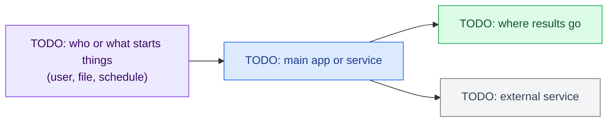

# Architecture

The map of this repo: what its parts are, how data flows between them, and where to change what.
Keep it current: a change that adds, removes or rewires a part updates the diagram in the same pull request
(`AGENTS.md`, section 11).

## Color palette

Use these colors in every diagram in this repo, so a color always means the same thing:

| Color | Meaning | Mermaid class |
| :--- | :--- | :--- |
| 🟦 Blue | Our code: apps, services, packages | `classDef ours fill:#dbeafe,stroke:#2563eb,color:#1e3a8a` |
| 🟪 Purple | Inputs: users, files, configuration, events | `classDef input fill:#ede9fe,stroke:#7c3aed,color:#3b0764` |
| 🟨 Yellow | Checks, rules and decisions | `classDef gate fill:#fef9c3,stroke:#ca8a04,color:#713f12` |
| 🟩 Green | Outputs and stored results | `classDef output fill:#dcfce7,stroke:#16a34a,color:#14532d` |
| ⬜ Grey | External systems we do not own | `classDef external fill:#f3f4f6,stroke:#6b7280,color:#374151` |
| 🟥 Red | Risks, failures, personal or secret data | `classDef risk fill:#fee2e2,stroke:#dc2626,color:#7f1d1d` |

## Parts and data flow

| Part | Folder | What it does | Talks to |
| :--- | :--- | :--- | :--- |
| TODO | `TODO/` | TODO | TODO |

## Where to change what

| To change... | Look in | Skill |
| :--- | :--- | :--- |
| TODO | `TODO` | `.agents/skills/TODO` |
